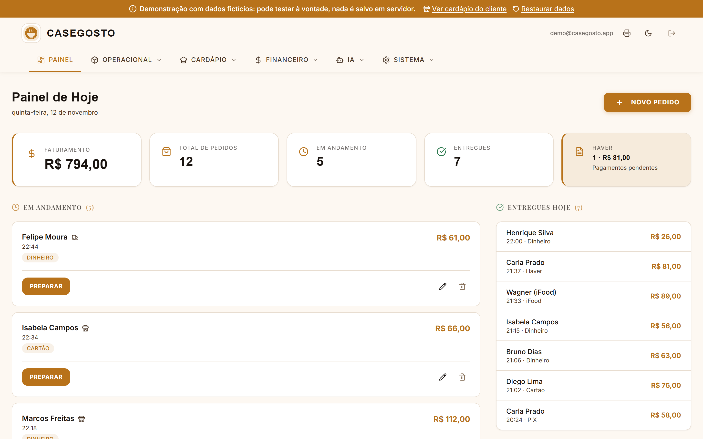
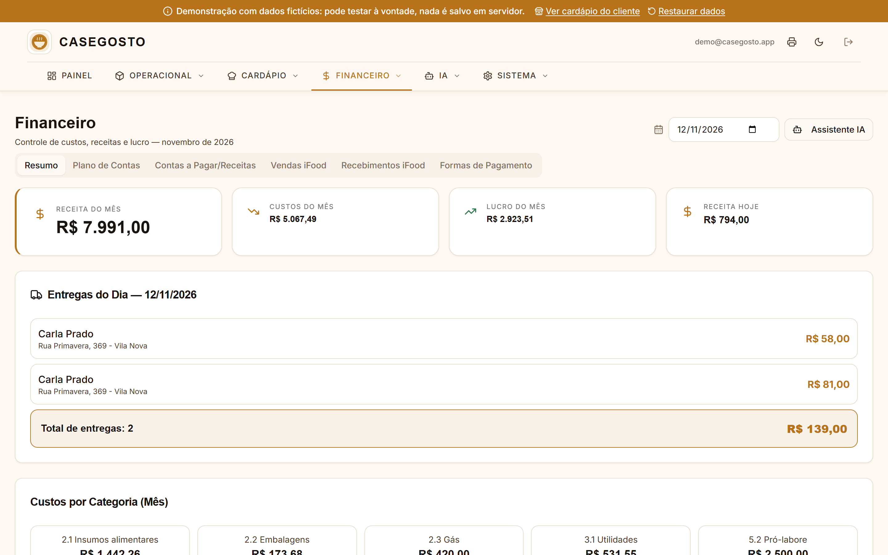
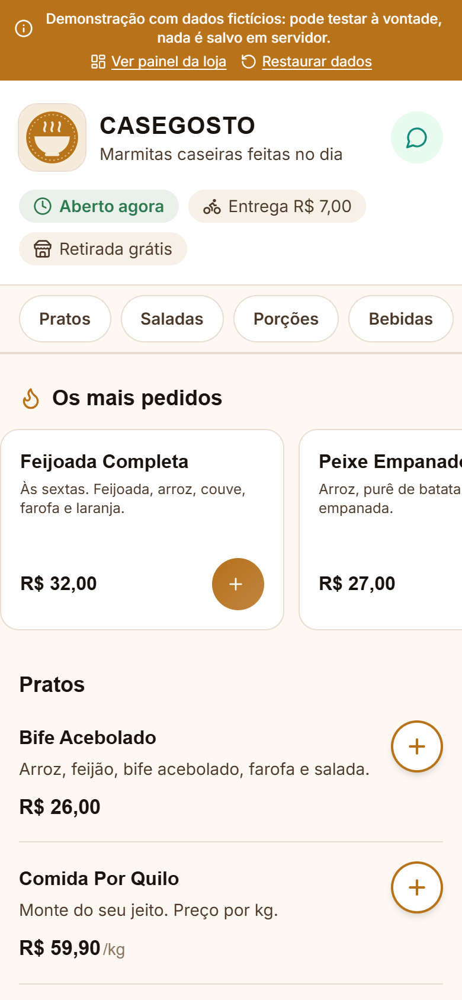
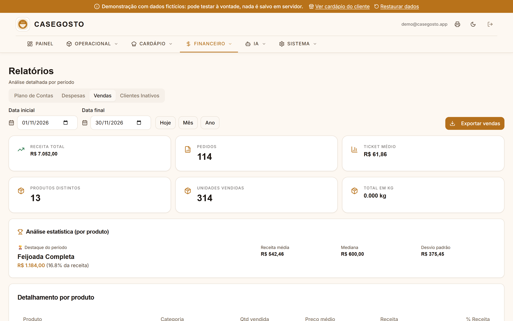
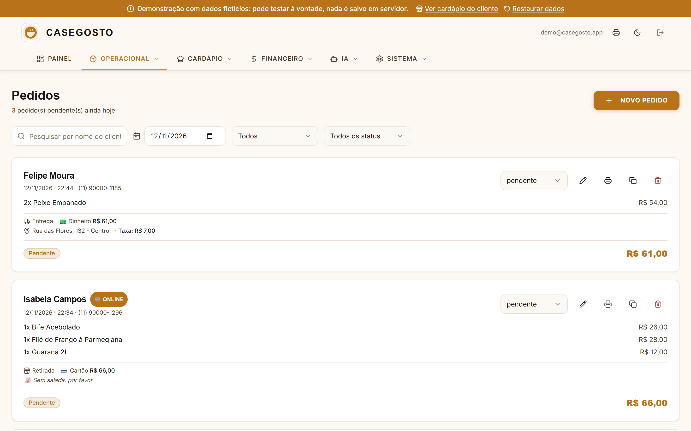
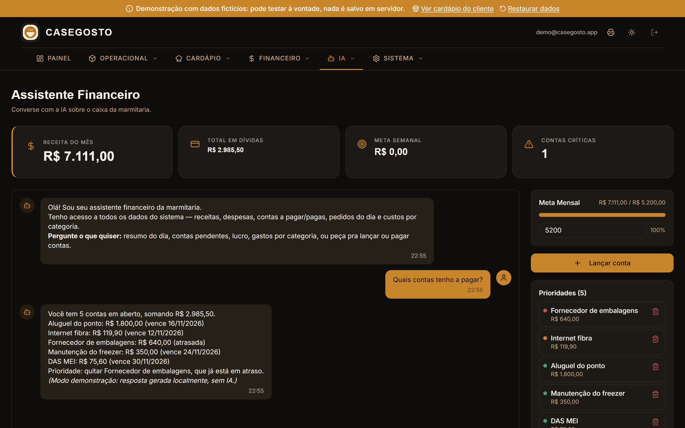

# CaseGosto: sistema de gestão para marmitaria

Sistema web feito para o dia a dia de uma marmitaria familiar. A cozinha recebe os
pedidos do balcão, do cardápio online e do iFood numa tela só, acompanha o preparo,
controla o estoque do dia e fecha o caixa com financeiro, relatórios e um assistente de IA.

> **Esta é a versão de vitrine (portfólio).** O código é o do sistema em produção, mas
> roda com um **banco de dados falso no navegador e dados 100% fictícios**. Nenhum
> cliente, telefone, valor ou chave real está neste repositório.

**▶ Demo online: [casegosto-vitrine.vercel.app](https://casegosto-vitrine.vercel.app)** (sem login: qualquer e-mail e senha entram)



## O que o sistema faz

| Área | Funcionalidades |
|---|---|
| **Pedidos** | Painel do dia com status (pendente → preparando → pronto → entregue), pagamento dividido entre várias formas, "haver" (fiado), impressão automática de cupom na térmica, busca de cliente por nome ou telefone |
| **Cardápio online** | Página pública e mobile-first para o cliente pedir sem login: carrinho, "mais pedidos", sugestão de bebida, retirada ou entrega, validação de estoque e confirmação pelo WhatsApp |
| **iFood** | Importa pedidos da Merchant API, confirma e sincroniza status, pausa itens sem estoque e concilia o repasse (comissão e taxas lançadas como despesa) |
| **Estoque e cardápio** | Estoque diário por item, itens por unidade ou por kg, fotos dos pratos (comprimidas no navegador antes do upload), prato do dia com ranking |
| **Financeiro** | Plano de contas (DRE simplificada de MEI), receitas e despesas por categoria, contas a pagar com prioridade, lucro do mês |
| **Relatórios** | Vendas por produto com estatística (média, mediana, desvio), despesas, clientes inativos com atalho para o WhatsApp, exportação CSV |
| **Assistente IA** | Chat sobre o caixa da loja: responde com os dados reais e registra ou dá baixa em contas por linguagem natural (Claude via API; na demo, as respostas são geradas localmente) |

<table>
  <tr>
    <td width="70%"></td>
    <td width="30%"></td>
  </tr>
  <tr>
    <td></td>
    <td></td>
  </tr>
</table>



## Stack

- **Front-end:** React 18, TypeScript, Vite, React Router, TanStack Query
- **UI:** Tailwind CSS, shadcn/ui (Radix), Recharts, tema claro/escuro
- **Back-end:** Supabase (Postgres com RLS, Auth, Storage, Edge Functions em Deno)
- **Integrações:** iFood Merchant API, Claude (Anthropic) para o assistente, WhatsApp via link
- **Testes:** Vitest (regras do cardápio, mapeamento de pedidos do iFood, telefones, imagem)
- **Deploy:** Vercel (front + função `/api/assistente`)

## Como rodar

```bash
npm install
npm run dev     # http://localhost:8080
npm run test
```

Sem nenhuma variável de ambiente o app abre direto no **modo demonstração**. Para ligar
num Supabase de verdade, copie `.env.example` para `.env`, preencha e aplique as
migrations de `supabase/migrations/`.

## Como funciona o modo demonstração

`src/integrations/supabase/client.ts` escolhe entre o cliente real do Supabase e
`demo-client.ts`, um cliente falso que implementa a parte da API usada pelo app:

- query builder encadeável (`select`, `insert`, `update`, `upsert`, `delete`, `eq`,
  `gte`, `in`, `or`, `order`, `limit`, `single`...), inclusive selects aninhados
  como `orders(*, order_items(*, menu_items(name)))` e `!inner`;
- `rpc` das funções SQL, `auth`, `storage` (fotos viram data URL) e `functions.invoke`;
- dados gerados por `demo-seed.ts` a partir da data de hoje (45 dias de pedidos,
  clientes, despesas, contas e pedidos do iFood), salvos no `localStorage` do visitante.

Assim o código das telas é exatamente o mesmo da versão em produção.

## Estrutura

```
src/
  pages/            telas (Painel, Pedidos, Cardápio online, Financeiro, Relatórios...)
  components/       componentes do app + shadcn/ui
  services/         acesso a dados (uma função por consulta)
  hooks/            hooks do TanStack Query
  lib/              regras puras e testadas (cardápio, iFood, telefone, imagem)
  integrations/supabase/  cliente real, cliente de demonstração e tipos do banco
supabase/
  migrations/       esquema do banco e políticas RLS
  functions/        Edge Functions (iFood, assistente financeiro)
api/assistente.ts   função serverless da Vercel que conversa com a Claude
```
